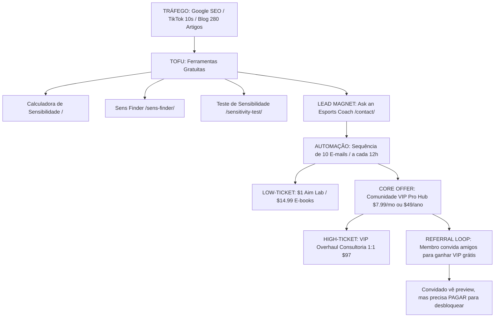

# DCPROSENS — FUNIL DE VENDAS & CAMPANHA DE 10 E-MAILS (12 em 12 Horas)

Este documento contém o planejamento comercial completo, a arquitetura do funil de vendas, as novas regras da comunidade e a sequência de 10 e-mails de alta conversão para transformar visitantes em assinantes da Comunidade VIP e compradores dos produtos.

---

## 1. O MAPA DO FUNIL DE VENDAS COMPLETO

### Níveis do Funil:
1. **Topo do Funil (Gratuito / Aquisição):**
   - Calculadora Universal de Sensibilidade (87 jogos).
   - 280 Artigos do Blog com schemas de SEO e AEO.
   - Vídeos virais de 10 segundos no TikTok / Reels.
   - Formulário de auditoria e perguntas: `/contact/`.
2. **Meio do Funil (Nutrição & Conversão Inicial):**
   - Automação de 10 E-mails (1 a cada 12 horas).
   - Aim Lab Standalone ($1) para quebrar a barreira do primeiro pagamento.
   - 6 E-books Técnicos ($14.99 cada) para resolver problemas específicos (Input Lag, Friction, Warm-up).
3. **Fundo do Funil (Recorrência & Alto Ticket):**
   - **Comunidade VIP Telemetry Hub:** $7.99/mês ou $49/ano ($4.08/mês) ou $129 Vitalício.
   - **Master Bundle de 6 E-books:** $47.
   - **Consultoria VIP 1:1 Overhaul:** $97 (auditoria completa de PC e mecânica com engenheiro).

---

## 2. A COMUNIDADE: SISTEMA DE COMPARTILHAMENTO & PAYWALL

### Como funciona no site:
1. **Link de Referral Dinâmico:** Cada usuário tem um link próprio (`https://dcprosens.com/community/?ref=SEU_CODIGO`).
2. **Botões de 1 Clique:** Atalhos diretos para WhatsApp, X/Twitter e Discord já disponíveis na sidebar da comunidade.
3. **Regra de Conversão:**
   - O amigo convidado entra e recebe um **guest preview** dos 3 primeiros tópicos com o restante borrado (blur glassmorphism).
   - Para interagir, baixar arquivos do Telemetry Vault ou ver os tópicos completos, ele **é obrigado a assinar a membership paga**.
   - O usuário que convidou ganha **1 Mês Grátis de VIP** quando o amigo assina.

---

## 3. SEQUÊNCIA DE 10 E-MAILS (DISPARO A CADA 12 HORAS)

Remetente institucional recomendado: **Coach Dalto | DCPROSENS** (`coach@dcprosens.com` ou `support@dcprosens.com`).

---

### E-MAIL 01 (Hora 0 — Boas-vindas & Diagnóstico Imediato)
**Assunto:** [Diagnóstico] Sua sensibilidade está calibrada ou você está compensando?  
**Preview:** Veja o primeiro passo para alinhar seu hardware e sua mira agora.  

> Fala, guerreiro! Aqui é o Dalto do DCPROSENS.
>
> Você acabou de dar o passo que 95% dos jogadores ignoram: parar de adivinhar e começar a medir sua mira com base em física e engenharia.
>
> A maioria dos jogadores acha que mira ruim é falta de reflexo. Na prática, quase sempre é **ruído mecânico**: sensibilidade descalibrada para o tamanho do mousepad, aceleração oculta do Windows ou atraso no sensor do mouse.
>
> Antes de qualquer coisa, faça este teste rápido de 30 segundos:
> 1. Pegue sua sensibilidade atual e converta no nosso sistema: https://dcprosens.com
> 2. Anote o seu **cm/360** (quantos centímetros seu mouse precisa andar para dar uma volta completa).
> 
> Se você joga jogos táticos (Valorant/CS2) e seu cm/360 está abaixo de 30cm, você está exigindo precisão microscópica dos tendões do seu pulso. Se joga Apex/Warzone e passa de 60cm, você está se cansando desnecessariamente.
>
> Em 12 horas, vou te mandar o teste definitivo do porquê **800 DPI pode estar atrasando seus tiros** em comparação com 1600 DPI.
>
> Fique atento à sua caixa de entrada.
>
> Abraços,  
> **Dalto Santos — DCPROSENS**  
> *Founder & Aim Telemetry Specialist*

---

### E-MAIL 02 (Hora 12 — O Segredo de Hardware: 800 vs 1600 DPI)
**Assunto:** O atraso invisível do seu mouse (800 DPI vs 1600 DPI)  
**Preview:** Por que o primeiro milímetro do seu movimento pode estar levando o dobro do tempo.  

> Sabia que o seu mouse não envia movimento para o PC em tempo real contínuo?
>
> Ele precisa acumular **1 contagem (count)** no sensor óptico antes de disparar o pacote USB.
>
> Faça as contas com a gente:
> * Em **400 DPI**, o mouse precisa se mover **0.0635 mm** para o primeiro sinal sair. Em movimentos lentos de ajuste fino na cabeça do inimigo, isso gera até **6 milissegundos de atraso puro**.
> * Em **800 DPI**, a distância cai para **0.0318 mm**.
> * Em **1600 DPI**, a distância cai para apenas **0.0159 mm** — a resposta é praticamente instantânea!
>
> **A recomendação dos engenheiros do DCPROSENS:**
> Suba seu mouse para **1600 DPI** e divida sua sensibilidade dentro do jogo por 2.
>
> O seu cm/360 continuará **exatamente o mesmo**, mas seus micro-ajustes ficarão imediatos.
>
> Quer entender mais a fundo sobre latência de clique-para-fóton?
> Dá uma olhada no nosso artigo completo no blog:  
> 🔗 https://dcprosens.com/blog/1600-dpi-vs-800-dpi-input-lag-latency/
>
> Te vejo no próximo e-mail com a verdade sobre copiar configs de pro players.
>
> **Dalto — DCPROSENS**

---

### E-MAIL 03 (Hora 24 — A Armadilha: Copiar Sensibilidade de Pro Player)
**Assunto:** Pare de copiar a sensibilidade do TenZ ou do Aspas 🛑  
**Preview:** O motivo pelo qual a config deles não funciona na sua mesa.  

> Vamos direto ao ponto:
>
> Quantas vezes você viu um pro player destruindo no campeonato, copiou a sensibilidade dele na mesma hora e jogou pior do que antes?
>
> Isso acontece porque a sensibilidade de um pro player não existe no vácuo. Ela depende de:
> 1. **Fricção do Mousepad:** O Aspas usa um mousepad com base xsoft específico. Se você usa um pad de pano genérico ou rígido, a velocidade é completamente diferente.
> 2. **Biomecânica do Braço:** Se o pro mira com o cotovelo apoiado na mesa e você mira com o pulso ancorado na borda, a alavanca muscular é oposta.
> 3. **Espaço Físico de Mesa:** Copiar 55cm/360 com um mousepad pequeno de 30cm só vai te fazer bater o mouse no teclado no meio do clutch.
>
> Em vez de copiar cegamente, use o método matemático PSA para descobrir a sua própria sensibilidade natural:  
> 🔗 https://dcprosens.com/psa-calculator/
>
> Daqui a 12 horas, vou te mostrar como zerar as micro-travadas do Windows 11.
>
> **Dalto — DCPROSENS**

---

### E-MAIL 04 (Hora 36 — Zero Delay: Eliminando DPC Latency no Windows)
**Assunto:** Suas balas somem no jogo? Pode ser DPC Latency do Windows  
**Preview:** Como isolar travamentos de drivers de GPU e placa de rede.  

> Você já sentiu que acertou o tiro na cabeça do adversário, mas a bala simplesmente "não registrou"?
>
> Na maioria dos casos, isso não é apenas ping ou netcode do jogo. É **DPC Latency (Deferred Procedure Call)** do Windows.
>
> Quando um driver mal otimizado (como o de áudio HDMI da placa de vídeo ou economia de energia da placa de rede) trava o processador por 2 milissegundos, o jogo sofre um micro-stutter que bagunça o registro de tiro naquele instante crítico.
>
> **3 Passos rápidos para testar no seu PC:**
> 1. Baixe o software gratuito **LatencyMon** e rode por 10 minutos jogando.
> 2. Veja se a aba *Drivers* tem algum driver ultrapassando 1.0 ms (especialmente `nvlddmkm.sys` ou `ndis.sys`).
> 3. Coloque o plano de energia do Windows em *Desempenho Máximo* para evitar que o clock da CPU caia no meio da partida.
>
> Temos um guia passo a passo completo sobre isso no blog:  
> 🔗 https://dcprosens.com/blog/dpc-latency-spikes-windows-11-micro-stutter-guide/
>
> No próximo e-mail: a física por trás do Peeker's Advantage e como nunca mais tomar pré-fogo.
>
> **Dalto — DCPROSENS**

---

### E-MAIL 05 (Hora 48 — Geometria Tática: O Fim do Pré-Fogo)
**Assunto:** A matemática do Peeker's Advantage (e como se defender)  
**Preview:** Por que quem abre a esquina sempre vê primeiro e o que fazer a respeito.  

> No Valorant e no Counter-Strike 2, todo mundo reclama do "peeker's advantage".
>
> Mas você sabia que 50% dessa vantagem não é culpa da internet, e sim de **pura geometria**?
>
> Se você segura um pixel colado na parede da quina, o seu ombro aparece no campo de visão do atacante muito antes dos seus olhos enxergarem a quina da parede.
>
> **As duas regras de ouro dos campeonatos:**
> 1. **Fique o mais longe possível da quina:** Quanto maior a sua distância do obstáculo, maior o seu ângulo de visão antes do oponente te avistar.
> 2. **Segure off-angles dinâmicos:** Nunca fique onde todo mundo mira por padrão. Abra um passo a mais e force o atacante a fazer um micro-flick reativo em vez de dar o pré-tiro no automático.
>
> Quer dominar o posicionamento de mira dos profissionais?  
> 🔗 https://dcprosens.com/blog/peekers-advantage-netcode-delay-explained/
>
> Daqui a 12 horas, falaremos sobre a peça mais subestimada do seu setup: a superfície onde o mouse desliza.
>
> **Dalto — DCPROSENS**

---

### E-MAIL 06 (Hora 60 — Mousepads: Fricção Estática vs Poder de Parada)
**Assunto:** Seu mousepad está 'pesado'? Pode ser umidade e desgaste  
**Preview:** O segredo entre pads de vidro, híbridos e Poron de controle.  

> Você acorda num dia quente ou chuvoso e parece que sua sensibilidade ficou mais lenta do nada?
>
> Não é sua imaginação. Mousepads tradicionais de pano absorvem a umidade do ar e o suor da mão, alterando o coeficiente de fricção estática em até 20%.
>
> É por isso que muitos jogadores profissionais mudaram para pads híbridos com base de Poron japonês (como Artisan ou Saturn Pro) ou vidro temperado:
> * **Mousepads de Vidro:** Fricção estática quase zero. Excelente para rastreio em Apex e Overwatch, mas exige controle muscular absurdo para travar a mira na cabeça no Valorant.
> * **Pads de Controle com Base Macia:** Ao apertar o mouse para baixo, os pés afundam na espuma criando um freio mecânico que garante a estabilidade do clique.
>
> Se você quer entender qual superfície combina com o seu estilo de pegada:  
> 🔗 https://dcprosens.com/blog/glass-mousepad-vs-cloth-stopping-power-comparison/
>
> No próximo e-mail: vou te apresentar o nosso **Hub VIP de Telemetria**. Chega de ruído e achismo.
>
> **Dalto — DCPROSENS**

---

### E-MAIL 07 (Hora 72 — Apresentação da Comunidade VIP)
**Assunto:** Chega de servidores caóticos de Discord: Conheça o Pro Hub ⚡  
**Preview:** Análises de VOD com coaches, scripts de zero latency e squad sem toxicidade.  

> Você já tentou tirar dúvidas sobre configurações em servidores públicos de Discord ou Reddit?
>
> 90% das respostas são trolls, pessoas mandando você "apenas treinar mais", ou debates vazios sem nenhum embasamento técnico.
>
> Por isso nós criamos a **Comunidade VIP DCPROSENS**:
> Um ambiente nativo, privado e focado 100% em telemetria, mecânica esportiva e desempenho de alto nível.
>
> **O que nossos membros têm acesso imediato:**
> * 📥 **Telemetry Vault:** Scripts de otimização de registro do Windows, autoexecs de sub-tick do CS2 e playlists de KovaaK's testadas em laboratório.
> * 🎯 **VOD Reviews:** Análises mecânicas detalhadas das jogadas e dos erros de mira.
> * 🛡️ **Squads Sem Toxicidade:** Encontre duos e trios de alto elo (Immortal, Radiant, Faceit Level 10) que jogam sério.
> * 💬 **Acesso Direto aos Coaches:** Nenhuma dúvida fica sem resposta técnica.
>
> Enquanto plataformas como Aimlabs+ cobram $12.99/mês e ProGuides $9.99/mês, o nosso passe começa em apenas **$4.08/mês** no plano anual:
>
> 👉 **Conheça e desbloqueie seu acesso VIP:**  
> https://dcprosens.com/community/
>
> Te vejo do lado de dentro!
>
> **Dalto — DCPROSENS**

---

### E-MAIL 08 (Hora 84 — Estudo de Caso: De Hardstuck a Imortal em 14 Dias)
**Assunto:** [Estudo de Caso] Como o Lucas saiu do Ouro para o Imortal  
**Preview:** O protocolo de 15 minutos que mudou o resultado das partidas ranqueadas.  

> Quando o Lucas entrou na comunidade do DCPROSENS, ele estava preso no Ouro havia 4 atos seguidos.
>
> Ele trocava de sensibilidade praticamente todo dia: se errava um tiro em uma partida, abria o menu e mudava o DPI. Ele achava que faltava talento.
>
> Quando auditamos o setup dele na comunidade, identificamos 3 erros simples:
> 1. O monitor dele de 165Hz estava rodando a 60Hz no Windows desde que comprou.
> 2. Ele usava 22cm/360 com pegada de braço, forçando o pulso até doer.
> 3. Ele começava a ranqueada frio, sem nenhum aquecimento neural.
>
> Aplicamos o protocolo de calibração do nosso Field Guide, travamos a sensibilidade dele por 14 dias seguidos e aplicamos a rotina de aquecimento biomecânico de 15 minutos.
>
> **Resultado:** Em 2 semanas o aproveitamento de headshots dele subiu de 14% para 29%, e em 40 dias ele conquistou o Imortal.
>
> Se você quer parar de perder tempo cometendo os mesmos erros:  
> 🔗 Junte-se à Comunidade VIP: https://dcprosens.com/community/  
> 🔗 Ou pegue o Guia Completo: https://dcprosens.com/ebooks/
>
> **Dalto — DCPROSENS**

---

### E-MAIL 09 (Hora 96 — Quebra de Objeções: Vale a pena investir em você?)
**Assunto:** "Mas vale a pena pagar por uma comunidade gamer?"  
**Preview:** Faça as contas do que você já gastou em skins versus na sua evolução real.  

> Sejamos honestos:
>
> A maioria dos jogadores não pensa duas vezes antes de gastar R$ 150 ou R$ 300 numa skin de arma bonita no jogo.
>
> Uma skin muda o visual da sua tela, mas não te faz acertar nenhum tiro a mais.
>
> Investir em **conhecimento técnico, telemetria e acompanhamento de ponta** é o que separa quem fica estagnado no mesmo elo por anos de quem realmente compete em alto nível.
>
> No DCPROSENS VIP, com menos do que o valor de um lanche por mês, você tem:
> * Acesso a todos os scripts e atualizações do nosso Telemetry Vault.
> * Avaliação direta de configurações por quem entende de física e engenharia de periféricos.
> * Um grupo de jogadores que pensam como você e querem subir juntos.
>
> E o melhor: você conta com **14 dias de garantia total**. Se entrar e achar que não agregou à sua gameplay, basta um clique e devolvemos 100% do valor.
>
> 👉 **Dê o salto na sua gameplay agora:**  
> https://dcprosens.com/community/
>
> **Dalto — DCPROSENS**

---

### E-MAIL 10 (Hora 108 — Última Chamada & Bônus de Entrada)
**Assunto:** [Última Chance] Bônus exclusivo: Telemetry Vault Desbloqueado  
**Preview:** O convite final para fazer parte da elite do DCPROSENS.  

> Esta é a última mensagem desta série especial de telemetria de mira.
>
> Durante esses últimos dias, te mostrei:
> * Por que 1600 DPI reduz o delay no primeiro movimento;
> * Como o DPC Latency rouba registros de tiro sem você perceber;
> * A geometria para vencer o peeker's advantage;
> * E como a consistência muscular é a única chave real para o topo.
>
> Agora a escolha é sua: continuar jogando no escuro, trocando de sensibilidade a cada partida ruim... ou se juntar à elite competitiva que joga com base em dados.
>
> Se você assinar o plano anual da Comunidade VIP hoje por apenas **$4.08/mês**, você ganha acesso instantâneo a todos os downloads do **Telemetry Vault** e às discussões privadas de coaches.
>
> 👉 **Entre para o DCPROSENS Pro Hub agora:**  
> https://dcprosens.com/community/
>
> E se precisar de uma consultoria completa 1:1 onde eu pessoalmente calibro seu PC e sua mira, conheça o nosso Overhaul:  
> https://dcprosens.com/vip-overhaul/
>
> Nos vemos nos servidores!
>
> Um forte abraço,  
> **Dalto Santos**  
> *DCPROSENS Lead Engineer & Aim Coach*  
> https://dcprosens.com
